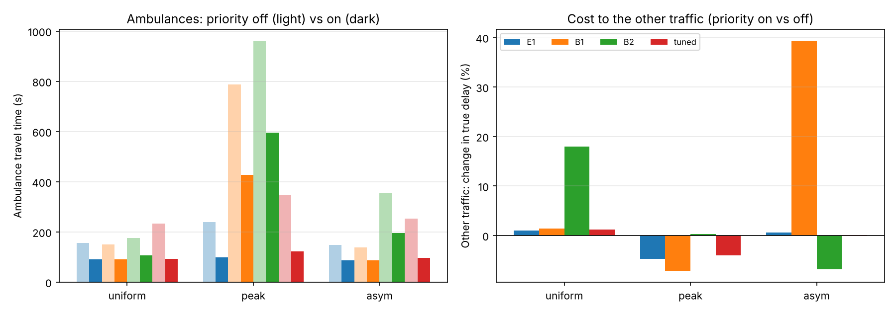

# Ambulances and signal priority

11 ambulances per episode, the same for every controller; priority off vs on, greedy, 10 seeds x 3 scenarios. Made by `scripts/analyze_ambulance.py`.

## Summary

| Controller | Scenario | Amb. travel off (s) | on (s) | change % | Stops off | on | Arrived off | on | of | Other delay off (s) | on (s) | change % |
|---|---|---|---|---|---|---|---|---|---|---|---|---|
| E1 | uniform | 155.2 | 90.0 | -42.0 | 4.62 | 0.00 | 110 | 110 | 110 | 33.9 | 34.3 | 1.0 |
| E1 | peak | 239.9 | 98.8 | -58.8 | 7.72 | 0.35 | 110 | 110 | 110 | 94.9 | 90.4 | -4.7 |
| E1 | asym | 148.4 | 86.4 | -41.8 | 4.66 | 0.01 | 110 | 110 | 110 | 35.1 | 35.3 | 0.6 |
| E1 | all | 181.2 | 91.7 | -49.4 | 5.67 | 0.12 | 330 | 330 | 330 | 54.6 | 53.3 | -2.4 |
| B1 | uniform | 148.9 | 90.4 | -39.3 | 4.75 | 0.00 | 110 | 110 | 110 | 29.9 | 30.3 | 1.4 |
| B1 | peak | 787.4 | 427.0 | -45.8 | 5.67 | 1.04 | 51 | 74 | 110 | 668.3 | 620.6 | -7.1 |
| B1 | asym | 137.2 | 86.4 | -37.0 | 4.21 | 0.02 | 110 | 110 | 110 | 26.7 | 37.2 | 39.3 |
| B1 | all | 357.8 | 201.3 | -43.7 | 4.88 | 0.35 | 271 | 294 | 330 | 241.6 | 229.4 | -5.1 |
| B2 | uniform | 175.3 | 106.1 | -39.5 | 4.83 | 0.06 | 107 | 108 | 110 | 51.6 | 61.0 | 18.0 |
| B2 | peak | 958.6 | 595.9 | -37.8 | 6.96 | 1.24 | 45 | 58 | 110 | 838.7 | 841.0 | 0.3 |
| B2 | asym | 355.7 | 195.1 | -45.2 | 4.07 | 0.15 | 85 | 97 | 110 | 190.4 | 177.4 | -6.8 |
| B2 | all | 496.6 | 299.0 | -39.8 | 5.29 | 0.48 | 237 | 263 | 330 | 360.3 | 359.8 | -0.1 |
| tuned | uniform | 232.1 | 93.1 | -59.9 | 4.24 | 0.01 | 107 | 110 | 110 | 93.4 | 94.5 | 1.2 |
| tuned | peak | 347.3 | 122.6 | -64.7 | 6.26 | 0.79 | 103 | 110 | 110 | 172.0 | 165.0 | -4.0 |
| tuned | asym | 253.2 | 97.0 | -61.7 | 4.77 | 0.18 | 106 | 109 | 110 | 127.2 | 127.0 | -0.1 |
| tuned | all | 277.5 | 104.2 | -62.4 | 5.09 | 0.33 | 316 | 329 | 330 | 130.9 | 128.8 | -1.5 |

## Paired tests (Wilcoxon, Holm-corrected within each metric)

`lower_with_priority` = number of the 10 seeds where the value is lower with priority.

| controller | scenario | metric | mean_off | mean_on | lower_with_priority | p (Holm) |
|---|---|---|---|---|---|---|
| E1 | uniform | amb_travel_time | 155.24 | 90.05 | 10 | 0.023 |
| E1 | uniform | amb_stops | 4.62 | 0.00 | 10 | 0.023 |
| E1 | uniform | amb_wait | 46.83 | 0.00 | 10 | 0.023 |
| E1 | uniform | true_delay | 33.92 | 34.27 | 2 | 0.516 |
| E1 | peak | amb_travel_time | 239.88 | 98.75 | 10 | 0.023 |
| E1 | peak | amb_stops | 7.72 | 0.35 | 10 | 0.023 |
| E1 | peak | amb_wait | 113.05 | 1.43 | 10 | 0.023 |
| E1 | peak | true_delay | 94.94 | 90.43 | 10 | 0.023 |
| E1 | asym | amb_travel_time | 148.35 | 86.38 | 10 | 0.023 |
| E1 | asym | amb_stops | 4.66 | 0.01 | 10 | 0.023 |
| E1 | asym | amb_wait | 44.07 | 0.03 | 10 | 0.023 |
| E1 | asym | true_delay | 35.08 | 35.29 | 4 | 1.000 |
| B1 | uniform | amb_travel_time | 148.90 | 90.43 | 10 | 0.023 |
| B1 | uniform | amb_stops | 4.75 | 0.00 | 10 | 0.023 |
| B1 | uniform | amb_wait | 40.79 | 0.00 | 10 | 0.023 |
| B1 | uniform | true_delay | 29.90 | 30.31 | 3 | 0.516 |
| B1 | peak | amb_travel_time | 787.35 | 427.01 | 10 | 0.023 |
| B1 | peak | amb_stops | 5.67 | 1.04 | 10 | 0.023 |
| B1 | peak | amb_wait | 190.99 | 106.37 | 7 | 0.160 |
| B1 | peak | true_delay | 668.28 | 620.55 | 7 | 1.000 |
| B1 | asym | amb_travel_time | 137.21 | 86.39 | 10 | 0.023 |
| B1 | asym | amb_stops | 4.21 | 0.02 | 10 | 0.023 |
| B1 | asym | amb_wait | 34.72 | 0.22 | 10 | 0.023 |
| B1 | asym | true_delay | 26.73 | 37.25 | 1 | 0.059 |
| B2 | uniform | amb_travel_time | 175.33 | 106.10 | 9 | 0.023 |
| B2 | uniform | amb_stops | 4.83 | 0.06 | 10 | 0.023 |
| B2 | uniform | amb_wait | 49.81 | 5.73 | 9 | 0.023 |
| B2 | uniform | true_delay | 51.65 | 60.96 | 3 | 1.000 |
| B2 | peak | amb_travel_time | 958.63 | 595.87 | 10 | 0.023 |
| B2 | peak | amb_stops | 6.96 | 1.24 | 10 | 0.023 |
| B2 | peak | amb_wait | 402.82 | 82.44 | 8 | 0.039 |
| B2 | peak | true_delay | 838.75 | 840.98 | 6 | 1.000 |
| B2 | asym | amb_travel_time | 355.73 | 195.10 | 9 | 0.037 |
| B2 | asym | amb_stops | 4.07 | 0.15 | 10 | 0.023 |
| B2 | asym | amb_wait | 50.82 | 10.15 | 8 | 0.029 |
| B2 | asym | true_delay | 190.44 | 177.44 | 6 | 1.000 |
| tuned | uniform | amb_travel_time | 232.10 | 93.15 | 10 | 0.023 |
| tuned | uniform | amb_stops | 4.24 | 0.01 | 10 | 0.023 |
| tuned | uniform | amb_wait | 120.97 | 0.02 | 10 | 0.023 |
| tuned | uniform | true_delay | 93.42 | 94.51 | 0 | 0.023 |
| tuned | peak | amb_travel_time | 347.27 | 122.55 | 10 | 0.023 |
| tuned | peak | amb_stops | 6.26 | 0.79 | 10 | 0.023 |
| tuned | peak | amb_wait | 203.34 | 19.44 | 10 | 0.023 |
| tuned | peak | true_delay | 171.96 | 165.01 | 8 | 0.439 |
| tuned | asym | amb_travel_time | 253.22 | 96.96 | 10 | 0.023 |
| tuned | asym | amb_stops | 4.77 | 0.18 | 10 | 0.023 |
| tuned | asym | amb_wait | 140.76 | 1.23 | 10 | 0.023 |
| tuned | asym | true_delay | 127.18 | 127.00 | 3 | 1.000 |

