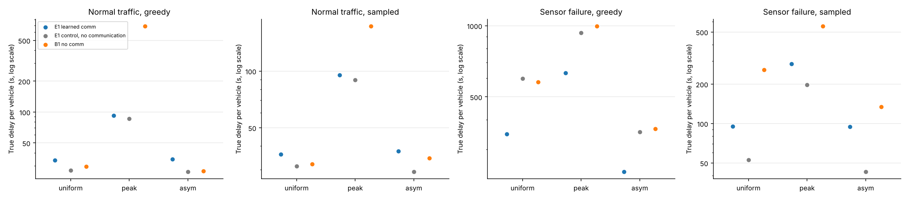

# No-communication control

`E1_nocomm` has exactly E1's network, loss (including the diversity penalty) and training settings (same training seed 0, same 500k steps), but the neighbour message it receives is replaced by zeros, so it cannot communicate (checked by `tests/test_nocomm.py`). E1 vs the control isolates the effect of communication; the control vs B1 isolates the effect of the E1 network and loss without communication. Made by `scripts/analyze_extensions.py`.

## Results

| Test | Mode | Controller | Scenario | True delay (s) | Entered % | Gridlock episodes |
|---|---|---|---|---|---|---|
| normal | greedy | E1 | uniform | 33.9 | 100.0 | 0/10 |
| normal | greedy | E1 | peak | 92.1 | 100.0 | 0/10 |
| normal | greedy | E1 | asym | 34.8 | 100.0 | 0/10 |
| normal | greedy | E1_nocomm | uniform | 27.0 | 100.0 | 0/10 |
| normal | greedy | E1_nocomm | peak | 86.4 | 100.0 | 0/10 |
| normal | greedy | E1_nocomm | asym | 26.2 | 100.0 | 0/10 |
| normal | greedy | B1 | uniform | 29.5 | 100.0 | 0/10 |
| normal | greedy | B1 | peak | 685.2 | 83.9 | 10/10 |
| normal | greedy | B1 | asym | 26.6 | 100.0 | 0/10 |
| normal | sampled | E1 | uniform | 36.1 | 100.0 | 0/10 |
| normal | sampled | E1 | peak | 95.3 | 100.0 | 0/10 |
| normal | sampled | E1 | asym | 37.5 | 100.0 | 0/10 |
| normal | sampled | E1_nocomm | uniform | 31.3 | 100.0 | 0/10 |
| normal | sampled | E1_nocomm | peak | 89.8 | 100.0 | 0/10 |
| normal | sampled | E1_nocomm | asym | 29.2 | 100.0 | 0/10 |
| normal | sampled | B1 | uniform | 32.0 | 100.0 | 0/10 |
| normal | sampled | B1 | peak | 172.8 | 99.8 | 4/10 |
| normal | sampled | B1 | asym | 34.6 | 100.0 | 0/10 |
| failure | greedy | E1 | uniform | 348.5 | 95.7 | 10/10 |
| failure | greedy | E1 | peak | 630.9 | 88.4 | 10/10 |
| failure | greedy | E1 | asym | 241.3 | 98.9 | 10/10 |
| failure | greedy | E1_nocomm | uniform | 597.8 | 91.6 | 10/10 |
| failure | greedy | E1_nocomm | peak | 935.0 | 81.6 | 10/10 |
| failure | greedy | E1_nocomm | asym | 355.4 | 96.1 | 10/10 |
| failure | greedy | B1 | uniform | 577.5 | 90.5 | 10/10 |
| failure | greedy | B1 | peak | 994.6 | 74.8 | 10/10 |
| failure | greedy | B1 | asym | 366.3 | 94.6 | 10/10 |
| failure | sampled | E1 | uniform | 95.3 | 100.0 | 10/10 |
| failure | sampled | E1 | peak | 284.9 | 99.0 | 10/10 |
| failure | sampled | E1 | asym | 94.4 | 100.0 | 10/10 |
| failure | sampled | E1_nocomm | uniform | 52.9 | 100.0 | 10/10 |
| failure | sampled | E1_nocomm | peak | 196.9 | 99.6 | 10/10 |
| failure | sampled | E1_nocomm | asym | 42.9 | 100.0 | 9/10 |
| failure | sampled | B1 | uniform | 257.5 | 96.4 | 10/10 |
| failure | sampled | B1 | peak | 552.7 | 91.5 | 10/10 |
| failure | sampled | B1 | asym | 134.4 | 99.6 | 10/10 |

## Paired tests

| Condition | A | B | Scenario | A mean | B mean | Difference | Seeds A lower | p (Holm) |
|---|---|---|---|---|---|---|---|---|
| normal traffic, greedy | E1 | E1_nocomm | uniform | 33.9 | 27.0 | +25.6% | 0/10 | 0.012 |
| normal traffic, greedy | E1 | E1_nocomm | peak | 92.1 | 86.4 | +6.6% | 0/10 | 0.012 |
| normal traffic, greedy | E1 | E1_nocomm | asym | 34.8 | 26.2 | +32.5% | 0/10 | 0.012 |
| normal traffic, greedy | E1_nocomm | B1 | uniform | 27.0 | 29.5 | -8.5% | 10/10 | 0.012 |
| normal traffic, greedy | E1_nocomm | B1 | peak | 86.4 | 685.2 | -87.4% | 10/10 | 0.012 |
| normal traffic, greedy | E1_nocomm | B1 | asym | 26.2 | 26.6 | -1.3% | 6/10 | 0.275 |
| normal traffic, sampled | E1 | E1_nocomm | uniform | 36.1 | 31.3 | +15.5% | 0/10 | 0.012 |
| normal traffic, sampled | E1 | E1_nocomm | peak | 95.3 | 89.8 | +6.1% | 0/10 | 0.012 |
| normal traffic, sampled | E1 | E1_nocomm | asym | 37.5 | 29.2 | +28.4% | 0/10 | 0.012 |
| normal traffic, sampled | E1_nocomm | B1 | uniform | 31.3 | 32.0 | -2.3% | 8/10 | 0.037 |
| normal traffic, sampled | E1_nocomm | B1 | peak | 89.8 | 172.8 | -48.0% | 10/10 | 0.012 |
| normal traffic, sampled | E1_nocomm | B1 | asym | 29.2 | 34.6 | -15.4% | 8/10 | 0.020 |
| sensor failure, greedy | E1 | E1_nocomm | uniform | 348.5 | 597.8 | -41.7% | 10/10 | 0.012 |
| sensor failure, greedy | E1 | E1_nocomm | peak | 630.9 | 935.0 | -32.5% | 10/10 | 0.012 |
| sensor failure, greedy | E1 | E1_nocomm | asym | 241.3 | 355.4 | -32.1% | 10/10 | 0.012 |
| sensor failure, greedy | E1_nocomm | B1 | uniform | 597.8 | 577.5 | +3.5% | 1/10 | 0.027 |
| sensor failure, greedy | E1_nocomm | B1 | peak | 935.0 | 994.6 | -6.0% | 9/10 | 0.012 |
| sensor failure, greedy | E1_nocomm | B1 | asym | 355.4 | 366.3 | -3.0% | 6/10 | 0.232 |
| sensor failure, sampled | E1 | E1_nocomm | uniform | 95.3 | 52.9 | +80.2% | 0/10 | 0.012 |
| sensor failure, sampled | E1 | E1_nocomm | peak | 284.9 | 196.9 | +44.7% | 2/10 | 0.049 |
| sensor failure, sampled | E1 | E1_nocomm | asym | 94.4 | 42.9 | +120.0% | 0/10 | 0.012 |
| sensor failure, sampled | E1_nocomm | B1 | uniform | 52.9 | 257.5 | -79.5% | 10/10 | 0.012 |
| sensor failure, sampled | E1_nocomm | B1 | peak | 196.9 | 552.7 | -64.4% | 10/10 | 0.012 |
| sensor failure, sampled | E1_nocomm | B1 | asym | 42.9 | 134.4 | -68.1% | 10/10 | 0.012 |

