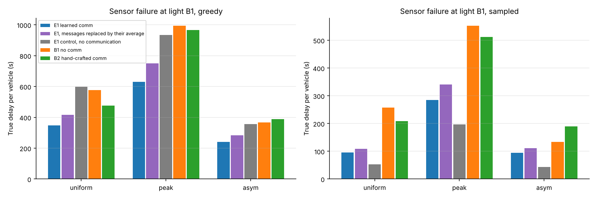

# Sensor failure at light B1

All 4 queue detectors of light B1 read 0 for the whole episode; every other light works normally. 10 seeds x 3 scenarios, paired with the same traffic. `failsafe` = the usual fallback for a flagged detector fault: the failed light runs tuned fixed-time (10 s greens), all other lights keep their agents. Made by `scripts/analyze_extensions.py`.

## Results

| Test | Mode | Controller | Scenario | True delay (s) | Entered % | Gridlock episodes |
|---|---|---|---|---|---|---|
| failure | greedy | E1 | uniform | 348.5 | 95.7 | 10/10 |
| failure | greedy | E1 | peak | 630.9 | 88.4 | 10/10 |
| failure | greedy | E1 | asym | 241.3 | 98.9 | 10/10 |
| failure | greedy | B1 | uniform | 577.5 | 90.5 | 10/10 |
| failure | greedy | B1 | peak | 994.6 | 74.8 | 10/10 |
| failure | greedy | B1 | asym | 366.3 | 94.6 | 10/10 |
| failure | greedy | B2 | uniform | 476.6 | 91.6 | 10/10 |
| failure | greedy | B2 | peak | 966.9 | 76.5 | 10/10 |
| failure | greedy | B2 | asym | 388.2 | 94.1 | 10/10 |
| failure | greedy | E1_ablated | uniform | 415.5 | 94.9 | 10/10 |
| failure | greedy | E1_ablated | peak | 749.8 | 85.4 | 10/10 |
| failure | greedy | E1_ablated | asym | 282.7 | 98.4 | 10/10 |
| failure | greedy | E1_nocomm | uniform | 597.8 | 91.6 | 10/10 |
| failure | greedy | E1_nocomm | peak | 935.0 | 81.6 | 10/10 |
| failure | greedy | E1_nocomm | asym | 355.4 | 96.1 | 10/10 |
| failure | sampled | E1 | uniform | 95.3 | 100.0 | 10/10 |
| failure | sampled | E1 | peak | 284.9 | 99.0 | 10/10 |
| failure | sampled | E1 | asym | 94.4 | 100.0 | 10/10 |
| failure | sampled | B1 | uniform | 257.5 | 96.4 | 10/10 |
| failure | sampled | B1 | peak | 552.7 | 91.5 | 10/10 |
| failure | sampled | B1 | asym | 134.4 | 99.6 | 10/10 |
| failure | sampled | B2 | uniform | 209.0 | 98.2 | 10/10 |
| failure | sampled | B2 | peak | 512.2 | 90.6 | 10/10 |
| failure | sampled | B2 | asym | 190.2 | 99.2 | 10/10 |
| failure | sampled | E1_ablated | uniform | 108.6 | 100.0 | 10/10 |
| failure | sampled | E1_ablated | peak | 340.7 | 97.6 | 10/10 |
| failure | sampled | E1_ablated | asym | 111.5 | 99.9 | 10/10 |
| failure | sampled | E1_nocomm | uniform | 52.9 | 100.0 | 10/10 |
| failure | sampled | E1_nocomm | peak | 196.9 | 99.6 | 10/10 |
| failure | sampled | E1_nocomm | asym | 42.9 | 100.0 | 9/10 |
| failsafe | greedy | E1 | uniform | 35.3 | 100.0 | 0/10 |
| failsafe | greedy | E1 | peak | 93.6 | 100.0 | 1/10 |
| failsafe | greedy | E1 | asym | 36.6 | 100.0 | 0/10 |
| failsafe | greedy | B1 | uniform | 31.2 | 100.0 | 0/10 |
| failsafe | greedy | B1 | peak | 648.7 | 85.3 | 10/10 |
| failsafe | greedy | B1 | asym | 29.0 | 100.0 | 0/10 |
| failsafe | greedy | B2 | uniform | 52.2 | 100.0 | 4/10 |
| failsafe | greedy | B2 | peak | 840.1 | 79.3 | 10/10 |
| failsafe | greedy | B2 | asym | 223.6 | 91.5 | 8/10 |

## Paired tests (E1 against each)

| Condition | E1 | Other | Scenario | E1 mean | Other mean | Difference | Seeds E1 lower | p (Holm) |
|---|---|---|---|---|---|---|---|---|
| sensor failure, greedy | E1 | B1 | uniform | 348.5 | 577.5 | -39.6% | 10/10 | 0.023 |
| sensor failure, greedy | E1 | B1 | peak | 630.9 | 994.6 | -36.6% | 10/10 | 0.023 |
| sensor failure, greedy | E1 | B1 | asym | 241.3 | 366.3 | -34.1% | 10/10 | 0.023 |
| sensor failure, greedy | E1 | B2 | uniform | 348.5 | 476.6 | -26.9% | 10/10 | 0.023 |
| sensor failure, greedy | E1 | B2 | peak | 630.9 | 966.9 | -34.8% | 10/10 | 0.023 |
| sensor failure, greedy | E1 | B2 | asym | 241.3 | 388.2 | -37.9% | 10/10 | 0.023 |
| sensor failure, greedy | E1 | E1_ablated | uniform | 348.5 | 415.5 | -16.1% | 10/10 | 0.023 |
| sensor failure, greedy | E1 | E1_ablated | peak | 630.9 | 749.8 | -15.9% | 10/10 | 0.023 |
| sensor failure, greedy | E1 | E1_ablated | asym | 241.3 | 282.7 | -14.6% | 10/10 | 0.023 |
| sensor failure, greedy | E1 | E1_nocomm | uniform | 348.5 | 597.8 | -41.7% | 10/10 | 0.023 |
| sensor failure, greedy | E1 | E1_nocomm | peak | 630.9 | 935.0 | -32.5% | 10/10 | 0.023 |
| sensor failure, greedy | E1 | E1_nocomm | asym | 241.3 | 355.4 | -32.1% | 10/10 | 0.023 |
| sensor failure, sampled | E1 | B1 | uniform | 95.3 | 257.5 | -63.0% | 10/10 | 0.023 |
| sensor failure, sampled | E1 | B1 | peak | 284.9 | 552.7 | -48.4% | 10/10 | 0.023 |
| sensor failure, sampled | E1 | B1 | asym | 94.4 | 134.4 | -29.8% | 10/10 | 0.023 |
| sensor failure, sampled | E1 | B2 | uniform | 95.3 | 209.0 | -54.4% | 10/10 | 0.023 |
| sensor failure, sampled | E1 | B2 | peak | 284.9 | 512.2 | -44.4% | 10/10 | 0.023 |
| sensor failure, sampled | E1 | B2 | asym | 94.4 | 190.2 | -50.4% | 10/10 | 0.023 |
| sensor failure, sampled | E1 | E1_ablated | uniform | 95.3 | 108.6 | -12.3% | 7/10 | 0.262 |
| sensor failure, sampled | E1 | E1_ablated | peak | 284.9 | 340.7 | -16.4% | 7/10 | 0.262 |
| sensor failure, sampled | E1 | E1_ablated | asym | 94.4 | 111.5 | -15.4% | 8/10 | 0.109 |
| sensor failure, sampled | E1 | E1_nocomm | uniform | 95.3 | 52.9 | +80.2% | 0/10 | 0.023 |
| sensor failure, sampled | E1 | E1_nocomm | peak | 284.9 | 196.9 | +44.7% | 2/10 | 0.146 |
| sensor failure, sampled | E1 | E1_nocomm | asym | 94.4 | 42.9 | +120.0% | 0/10 | 0.023 |
| fallback (failed light runs tuned fixed-time), greedy | E1 | B1 | uniform | 35.3 | 31.2 | +13.1% | 0/10 | 0.012 |
| fallback (failed light runs tuned fixed-time), greedy | E1 | B1 | peak | 93.6 | 648.7 | -85.6% | 10/10 | 0.012 |
| fallback (failed light runs tuned fixed-time), greedy | E1 | B1 | asym | 36.6 | 29.0 | +26.2% | 0/10 | 0.012 |
| fallback (failed light runs tuned fixed-time), greedy | E1 | B2 | uniform | 35.3 | 52.2 | -32.4% | 5/10 | 0.492 |
| fallback (failed light runs tuned fixed-time), greedy | E1 | B2 | peak | 93.6 | 840.1 | -88.9% | 10/10 | 0.012 |
| fallback (failed light runs tuned fixed-time), greedy | E1 | B2 | asym | 36.6 | 223.6 | -83.6% | 8/10 | 0.020 |

## Cost of the failure (same controller, normal vs failure)

| mode | controller | scenario | normal | failure | increase |
|---|---|---|---|---|---|
| greedy | E1 | uniform | 33.9 | 348.5 | +314.7 s |
| greedy | E1 | peak | 92.1 | 630.9 | +538.7 s |
| greedy | E1 | asym | 34.8 | 241.3 | +206.5 s |
| greedy | B1 | uniform | 29.5 | 577.5 | +548.1 s |
| greedy | B1 | peak | 685.2 | 994.6 | +309.4 s |
| greedy | B1 | asym | 26.6 | 366.3 | +339.7 s |
| greedy | B2 | uniform | 47.0 | 476.6 | +429.6 s |
| greedy | B2 | peak | 854.9 | 966.9 | +112.0 s |
| greedy | B2 | asym | 207.8 | 388.2 | +180.4 s |
| greedy | E1_nocomm | uniform | 27.0 | 597.8 | +570.8 s |
| greedy | E1_nocomm | peak | 86.4 | 935.0 | +848.6 s |
| greedy | E1_nocomm | asym | 26.2 | 355.4 | +329.1 s |
| sampled | E1 | uniform | 36.1 | 95.3 | +59.2 s |
| sampled | E1 | peak | 95.3 | 284.9 | +189.6 s |
| sampled | E1 | asym | 37.5 | 94.4 | +56.8 s |
| sampled | B1 | uniform | 32.0 | 257.5 | +225.5 s |
| sampled | B1 | peak | 172.8 | 552.7 | +379.9 s |
| sampled | B1 | asym | 34.6 | 134.4 | +99.8 s |
| sampled | B2 | uniform | 45.3 | 209.0 | +163.8 s |
| sampled | B2 | peak | 426.0 | 512.2 | +86.2 s |
| sampled | B2 | asym | 78.1 | 190.2 | +112.1 s |
| sampled | E1_nocomm | uniform | 31.3 | 52.9 | +21.6 s |
| sampled | E1_nocomm | peak | 89.8 | 196.9 | +107.1 s |
| sampled | E1_nocomm | asym | 29.2 | 42.9 | +13.7 s |

