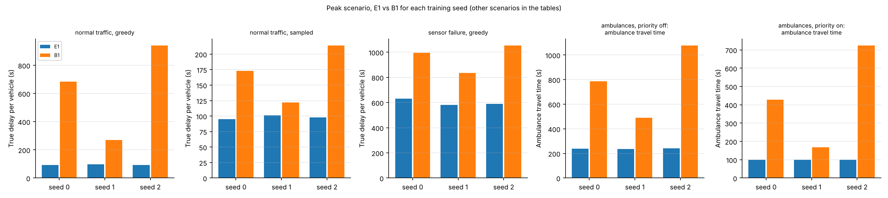

# Training seeds: is the E1 vs B1 result one lucky run?

E1 and B1 were each trained 3 times with the same settings and training seeds 0, 1 and 2. Each E1 run is compared with the B1 run of the same training seed, on the same traffic (10 seeds x 3 scenarios). Values: mean true delay per vehicle (s) or mean ambulance travel time (s), E1 vs B1, and who is significantly lower (Wilcoxon, Holm within each test and training seed). Made by `scripts/analyze_extensions.py`.

| Test | Training seed | uniform | peak | asym |
|---|---|---|---|---|
| normal traffic, greedy | 0 | 33.9 vs 29.5 (B1) | 92.1 vs 685.2 (E1) | 34.8 vs 26.6 (B1) |
| normal traffic, greedy | 1 | 38.2 vs 31.4 (B1) | 96.5 vs 268.7 (E1) | 40.4 vs 27.8 (B1) |
| normal traffic, greedy | 2 | 32.8 vs 45.8 (no sig. difference) | 93.2 vs 940.4 (E1) | 37.7 vs 166.6 (no sig. difference) |
| normal traffic, sampled | 0 | 36.1 vs 32.0 (B1) | 95.3 vs 172.8 (E1) | 37.5 vs 34.6 (no sig. difference) |
| normal traffic, sampled | 1 | 38.7 vs 33.0 (B1) | 101.1 vs 122.0 (E1) | 39.3 vs 31.0 (B1) |
| normal traffic, sampled | 2 | 35.7 vs 31.5 (B1) | 97.7 vs 213.9 (E1) | 40.6 vs 36.2 (no sig. difference) |
| sensor failure, greedy | 0 | 348.5 vs 577.5 (E1) | 630.9 vs 994.6 (E1) | 241.3 vs 366.3 (E1) |
| sensor failure, greedy | 1 | 259.7 vs 500.5 (E1) | 580.4 vs 835.1 (E1) | 318.7 vs 323.9 (no sig. difference) |
| sensor failure, greedy | 2 | 294.0 vs 526.1 (E1) | 588.4 vs 1053.1 (E1) | 246.1 vs 365.4 (E1) |
| ambulances, priority off: ambulance travel time | 0 | 155.2 vs 148.9 (B1) | 239.9 vs 787.4 (E1) | 148.4 vs 137.2 (B1) |
| ambulances, priority off: ambulance travel time | 1 | 158.7 vs 149.4 (B1) | 234.9 vs 489.4 (E1) | 158.3 vs 139.3 (B1) |
| ambulances, priority off: ambulance travel time | 2 | 148.7 vs 170.0 (no sig. difference) | 242.0 vs 1077.3 (E1) | 153.3 vs 308.3 (E1) |
| ambulances, priority on: ambulance travel time | 0 | 90.0 vs 90.4 (no sig. difference) | 98.8 vs 427.0 (E1) | 86.4 vs 86.4 (no sig. difference) |
| ambulances, priority on: ambulance travel time | 1 | 90.4 vs 90.2 (no sig. difference) | 99.6 vs 167.5 (E1) | 87.3 vs 85.8 (B1) |
| ambulances, priority on: ambulance travel time | 2 | 90.3 vs 96.2 (no sig. difference) | 99.1 vs 723.7 (E1) | 86.9 vs 237.6 (no sig. difference) |
| ambulances, priority off: other traffic | 0 | 33.9 vs 29.9 (B1) | 94.9 vs 668.3 (E1) | 35.1 vs 26.7 (B1) |
| ambulances, priority off: other traffic | 1 | 38.3 vs 31.4 (B1) | 98.6 vs 268.6 (E1) | 40.6 vs 28.3 (B1) |
| ambulances, priority off: other traffic | 2 | 33.2 vs 55.0 (no sig. difference) | 95.3 vs 964.9 (E1) | 37.9 vs 230.1 (E1) |
| ambulances, priority on: other traffic | 0 | 34.3 vs 30.3 (B1) | 90.4 vs 620.6 (E1) | 35.3 vs 37.2 (no sig. difference) |
| ambulances, priority on: other traffic | 1 | 38.5 vs 31.9 (B1) | 96.1 vs 242.3 (E1) | 41.3 vs 28.5 (B1) |
| ambulances, priority on: other traffic | 2 | 33.7 vs 63.8 (no sig. difference) | 91.1 vs 942.8 (E1) | 38.0 vs 222.1 (no sig. difference) |

## All paired tests

| Condition | E1 | B1 | Scenario | E1 mean | B1 mean | Difference | Seeds E1 lower | p (Holm) |
|---|---|---|---|---|---|---|---|---|
| normal traffic, greedy (training seed 0) | E1 | B1 | uniform | 33.9 | 29.5 | +15.0% | 0/10 | 0.006 |
| normal traffic, greedy (training seed 0) | E1 | B1 | peak | 92.1 | 685.2 | -86.6% | 10/10 | 0.006 |
| normal traffic, greedy (training seed 0) | E1 | B1 | asym | 34.8 | 26.6 | +30.8% | 0/10 | 0.006 |
| normal traffic, sampled (training seed 0) | E1 | B1 | uniform | 36.1 | 32.0 | +12.8% | 0/10 | 0.006 |
| normal traffic, sampled (training seed 0) | E1 | B1 | peak | 95.3 | 172.8 | -44.9% | 10/10 | 0.006 |
| normal traffic, sampled (training seed 0) | E1 | B1 | asym | 37.5 | 34.6 | +8.6% | 1/10 | 0.084 |
| sensor failure, greedy (training seed 0) | E1 | B1 | uniform | 348.5 | 577.5 | -39.6% | 10/10 | 0.006 |
| sensor failure, greedy (training seed 0) | E1 | B1 | peak | 630.9 | 994.6 | -36.6% | 10/10 | 0.006 |
| sensor failure, greedy (training seed 0) | E1 | B1 | asym | 241.3 | 366.3 | -34.1% | 10/10 | 0.006 |
| ambulances, priority off: ambulance travel time (training seed 0) | E1 | B1 | uniform | 155.2 | 148.9 | +4.3% | 1/10 | 0.027 |
| ambulances, priority off: ambulance travel time (training seed 0) | E1 | B1 | peak | 239.9 | 787.4 | -69.5% | 10/10 | 0.006 |
| ambulances, priority off: ambulance travel time (training seed 0) | E1 | B1 | asym | 148.4 | 137.2 | +8.1% | 0/10 | 0.006 |
| ambulances, priority on: ambulance travel time (training seed 0) | E1 | B1 | uniform | 90.0 | 90.4 | -0.4% | 7/10 | 0.414 |
| ambulances, priority on: ambulance travel time (training seed 0) | E1 | B1 | peak | 98.8 | 427.0 | -76.9% | 10/10 | 0.006 |
| ambulances, priority on: ambulance travel time (training seed 0) | E1 | B1 | asym | 86.4 | 86.4 | -0.0% | 5/10 | 0.863 |
| ambulances, priority off: other traffic (training seed 0) | E1 | B1 | uniform | 33.9 | 29.9 | +13.4% | 0/10 | 0.006 |
| ambulances, priority off: other traffic (training seed 0) | E1 | B1 | peak | 94.9 | 668.3 | -85.8% | 10/10 | 0.006 |
| ambulances, priority off: other traffic (training seed 0) | E1 | B1 | asym | 35.1 | 26.7 | +31.2% | 0/10 | 0.006 |
| ambulances, priority on: other traffic (training seed 0) | E1 | B1 | uniform | 34.3 | 30.3 | +13.0% | 0/10 | 0.006 |
| ambulances, priority on: other traffic (training seed 0) | E1 | B1 | peak | 90.4 | 620.6 | -85.4% | 10/10 | 0.006 |
| ambulances, priority on: other traffic (training seed 0) | E1 | B1 | asym | 35.3 | 37.2 | -5.2% | 1/10 | 0.084 |
| normal traffic, greedy (training seed 1) | E1 | B1 | uniform | 38.2 | 31.4 | +21.8% | 0/10 | 0.006 |
| normal traffic, greedy (training seed 1) | E1 | B1 | peak | 96.5 | 268.7 | -64.1% | 10/10 | 0.006 |
| normal traffic, greedy (training seed 1) | E1 | B1 | asym | 40.4 | 27.8 | +45.2% | 0/10 | 0.006 |
| normal traffic, sampled (training seed 1) | E1 | B1 | uniform | 38.7 | 33.0 | +17.3% | 0/10 | 0.006 |
| normal traffic, sampled (training seed 1) | E1 | B1 | peak | 101.1 | 122.0 | -17.2% | 10/10 | 0.006 |
| normal traffic, sampled (training seed 1) | E1 | B1 | asym | 39.3 | 31.0 | +26.6% | 0/10 | 0.006 |
| sensor failure, greedy (training seed 1) | E1 | B1 | uniform | 259.7 | 500.5 | -48.1% | 10/10 | 0.006 |
| sensor failure, greedy (training seed 1) | E1 | B1 | peak | 580.4 | 835.1 | -30.5% | 10/10 | 0.006 |
| sensor failure, greedy (training seed 1) | E1 | B1 | asym | 318.7 | 323.9 | -1.6% | 4/10 | 0.922 |
| ambulances, priority off: ambulance travel time (training seed 1) | E1 | B1 | uniform | 158.7 | 149.4 | +6.3% | 0/10 | 0.006 |
| ambulances, priority off: ambulance travel time (training seed 1) | E1 | B1 | peak | 234.9 | 489.4 | -52.0% | 10/10 | 0.006 |
| ambulances, priority off: ambulance travel time (training seed 1) | E1 | B1 | asym | 158.3 | 139.3 | +13.6% | 0/10 | 0.006 |
| ambulances, priority on: ambulance travel time (training seed 1) | E1 | B1 | uniform | 90.4 | 90.2 | +0.3% | 4/10 | 0.266 |
| ambulances, priority on: ambulance travel time (training seed 1) | E1 | B1 | peak | 99.6 | 167.5 | -40.5% | 10/10 | 0.006 |
| ambulances, priority on: ambulance travel time (training seed 1) | E1 | B1 | asym | 87.3 | 85.8 | +1.8% | 2/10 | 0.020 |
| ambulances, priority off: other traffic (training seed 1) | E1 | B1 | uniform | 38.3 | 31.4 | +21.8% | 0/10 | 0.006 |
| ambulances, priority off: other traffic (training seed 1) | E1 | B1 | peak | 98.6 | 268.6 | -63.3% | 10/10 | 0.006 |
| ambulances, priority off: other traffic (training seed 1) | E1 | B1 | asym | 40.6 | 28.3 | +43.8% | 0/10 | 0.006 |
| ambulances, priority on: other traffic (training seed 1) | E1 | B1 | uniform | 38.5 | 31.9 | +20.5% | 0/10 | 0.006 |
| ambulances, priority on: other traffic (training seed 1) | E1 | B1 | peak | 96.1 | 242.3 | -60.4% | 10/10 | 0.006 |
| ambulances, priority on: other traffic (training seed 1) | E1 | B1 | asym | 41.3 | 28.5 | +45.1% | 0/10 | 0.006 |
| normal traffic, greedy (training seed 2) | E1 | B1 | uniform | 32.8 | 45.8 | -28.4% | 3/10 | 1.000 |
| normal traffic, greedy (training seed 2) | E1 | B1 | peak | 93.2 | 940.4 | -90.1% | 10/10 | 0.006 |
| normal traffic, greedy (training seed 2) | E1 | B1 | asym | 37.7 | 166.6 | -77.4% | 6/10 | 0.168 |
| normal traffic, sampled (training seed 2) | E1 | B1 | uniform | 35.7 | 31.5 | +13.3% | 0/10 | 0.006 |
| normal traffic, sampled (training seed 2) | E1 | B1 | peak | 97.7 | 213.9 | -54.3% | 10/10 | 0.006 |
| normal traffic, sampled (training seed 2) | E1 | B1 | asym | 40.6 | 36.2 | +12.2% | 2/10 | 0.105 |
| sensor failure, greedy (training seed 2) | E1 | B1 | uniform | 294.0 | 526.1 | -44.1% | 10/10 | 0.006 |
| sensor failure, greedy (training seed 2) | E1 | B1 | peak | 588.4 | 1053.1 | -44.1% | 10/10 | 0.006 |
| sensor failure, greedy (training seed 2) | E1 | B1 | asym | 246.1 | 365.4 | -32.7% | 9/10 | 0.010 |
| ambulances, priority off: ambulance travel time (training seed 2) | E1 | B1 | uniform | 148.7 | 170.0 | -12.5% | 4/10 | 1.000 |
| ambulances, priority off: ambulance travel time (training seed 2) | E1 | B1 | peak | 242.0 | 1077.3 | -77.5% | 10/10 | 0.006 |
| ambulances, priority off: ambulance travel time (training seed 2) | E1 | B1 | asym | 153.3 | 308.3 | -50.3% | 8/10 | 0.020 |
| ambulances, priority on: ambulance travel time (training seed 2) | E1 | B1 | uniform | 90.3 | 96.2 | -6.2% | 3/10 | 0.992 |
| ambulances, priority on: ambulance travel time (training seed 2) | E1 | B1 | peak | 99.1 | 723.7 | -86.3% | 10/10 | 0.006 |
| ambulances, priority on: ambulance travel time (training seed 2) | E1 | B1 | asym | 86.9 | 237.6 | -63.4% | 7/10 | 0.055 |
| ambulances, priority off: other traffic (training seed 2) | E1 | B1 | uniform | 33.2 | 55.0 | -39.7% | 5/10 | 0.492 |
| ambulances, priority off: other traffic (training seed 2) | E1 | B1 | peak | 95.3 | 964.9 | -90.1% | 10/10 | 0.006 |
| ambulances, priority off: other traffic (training seed 2) | E1 | B1 | asym | 37.9 | 230.1 | -83.5% | 8/10 | 0.020 |
| ambulances, priority on: other traffic (training seed 2) | E1 | B1 | uniform | 33.7 | 63.8 | -47.2% | 4/10 | 0.557 |
| ambulances, priority on: other traffic (training seed 2) | E1 | B1 | peak | 91.1 | 942.8 | -90.3% | 10/10 | 0.006 |
| ambulances, priority on: other traffic (training seed 2) | E1 | B1 | asym | 38.0 | 222.1 | -82.9% | 7/10 | 0.055 |

